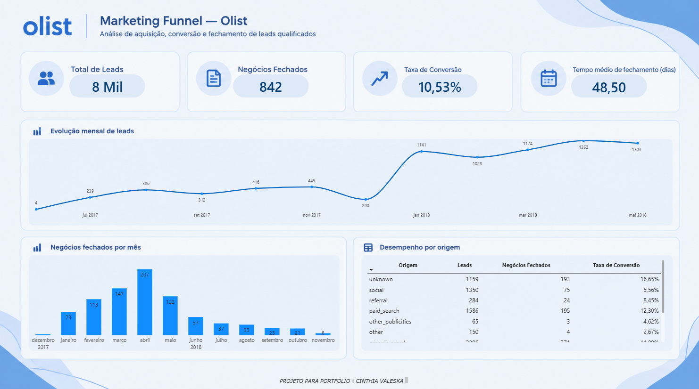

# Marketing Funnel Analysis — Olist

## Sobre o projeto

Este projeto tem como objetivo analisar o funil de marketing da Olist, investigando a relação entre leads qualificados e negócios fechados.

A análise busca compreender o volume de leads, a conversão observada, a evolução temporal e o desempenho das diferentes origens, gerando insights que podem apoiar decisões das áreas de marketing e vendas.

## Problema de negócio

- Quantos leads qualificados existem na base?
- Quantos negócios foram fechados?
- Qual é a taxa de conversão observada?
- Como a entrada de leads evolui ao longo do tempo?
- Quais origens apresentam maior volume de leads?
- Quais origens apresentam maior taxa de conversão?
- Quanto tempo os negócios levam para ser fechados?
- Existem diferenças no tempo de fechamento conforme a origem?

## Fonte de dados

Dataset **Marketing Funnel by Olist**, disponibilizado no Kaggle.

O projeto utiliza informações de leads qualificados e negócios fechados.

## Ferramentas utilizadas

- Python
- Pandas
- Jupyter Notebook
- PostgreSQL e SQL
- Power BI
- Git e GitHub

## Principais resultados

- **Leads qualificados:** 8.000
- **Negócios fechados registrados:** 842
- **Taxa de conversão observada:** 10,53%
- **Tempo médio de fechamento:** 48,50 dias, considerando apenas registros em que a data de fechamento não é anterior à data de entrada do lead.
- **Maior volume mensal de leads:** abril de 2018, com 1.352 leads registrados.
- **Maior volume mensal de negócios fechados:** abril de 2018, com 207 negócios.
- **Origem com maior volume de leads:** `organic_search`, com 2.296 leads.
- **Origem conhecida com maior taxa de conversão observada:** `paid_search`, com 12,30%.

Esses resultados são descritivos e representam os dados disponíveis na base analisada.

## Dashboard

O projeto inclui um dashboard desenvolvido no Power BI para apresentar os principais indicadores, a evolução mensal dos leads e dos negócios fechados, e o desempenho por origem.

## Estrutura do projeto

O repositório reúne os arquivos de análise, as consultas SQL utilizadas para responder às perguntas de negócio e a documentação dos resultados e insights.

## Limitações da análise

- A ausência de um negócio fechado na base analisada não significa necessariamente que o lead foi perdido definitivamente.
- A taxa de conversão representa a proporção de leads associados a negócios fechados na base disponível; ela não deve ser interpretada automaticamente como a taxa final de conversão de todos os leads ao longo de todo o seu ciclo.
- A cobertura temporal e a qualidade dos dados podem influenciar os resultados.
- Existe pelo menos um registro em que a data de fechamento é anterior à data de entrada do lead. Esse registro foi excluído do cálculo do tempo médio de fechamento, sem alteração das datas originais.
- A origem `unknown` representa uma atribuição desconhecida e não deve ser tratada como um canal de marketing identificado.
- Não foram calculados CAC ou ROAS, pois não há dados adequados de investimento e receita para esses indicadores.
- Diferenças observadas entre origens não demonstram, por si só, relações de causa e efeito.

## Status do projeto

Análise exploratória, consultas SQL e dashboard desenvolvidos para fins de aprendizado e portfólio de Análise de Dados.